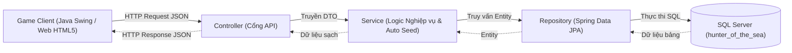

# Tài liệu Kiến trúc & Đặc tả API Backend (Hunter of the Sea)

**Dự án:** Hunter of the Sea  
**Nền tảng:** Java Spring Boot 3.2.4  
**Cơ sở dữ liệu:** Microsoft SQL Server (Hỗ trợ H2 In-Memory khi Dev/Test Offline)  

---

## 1. Tổng quan Công nghệ (Tech Stack)

* **Ngôn ngữ:** Java 17+ (Tương thích tốt trên OpenJDK 25/26).
* **Framework:** Spring Boot 3.2.4.
  * **Spring Web:** RESTful API đa nền tảng (hỗ trợ Java Desktop Swing, Web Canvas, Mobile).
  * **Spring Data JPA (Hibernate 6):** Ánh xạ đối tượng quan hệ, tự động khởi tạo bảng (`ddl-auto=update`).
* **Driver CSDL:** `mssql-jdbc` (Driver chính thức từ Microsoft) & `h2` (In-memory testing).
* **Hệ quản trị CSDL:** Microsoft SQL Server (Đăng nhập qua tài khoản `sa`).
* **Kiến trúc:** 3-Tier chuẩn mực:
  $$\text{Controller} \longrightarrow \text{Service} \longrightarrow \text{Repository} \longrightarrow \text{Database}$$

---

## 2. Sơ đồ Luồng Dữ liệu (Data Flow)



---

## 3. Cấu trúc Thư mục Dự án

```text
Backend/
├── pom.xml                                     # Cấu hình Maven (Spring Boot, MSSQL, H2)
├── test_dashboard.html                         # Giao diện trực quan kiểm thử toàn diện API
└── src/
    └── main/
        ├── java/com/game/hunter/
        │   ├── HunterApplication.java          # File khởi động chính của Spring Boot
        │   │
        │   ├── config/
        │   │   └── DataSeeder.java             # Tự động nạp 7 Thủy Thần & Config khi chạy lần đầu
        │   │
        │   ├── entity/                         # Ánh xạ bảng CSDL (JPA Entities)
        │   │   ├── GameConfig.java             # Bảng GameConfigs
        │   │   ├── GameCharacter.java          # Bảng Characters (7 Thủy Thần)
        │   │   ├── User.java                   # Bảng Users
        │   │   ├── Leaderboard.java            # Bảng Leaderboards
        │   │   ├── UserCharacter.java          # Bảng User_Characters (Mở khóa)
        │   │   ├── UserCharacterId.java        # Khóa chính phức hợp
        │   │   └── PvpMatchHistory.java        # Bảng Pvp_Match_History
        │   │
        │   ├── repository/                     # Tầng truy vấn Spring Data JPA
        │   │   ├── GameConfigRepository.java
        │   │   ├── GameCharacterRepository.java
        │   │   ├── UserRepository.java
        │   │   ├── LeaderboardRepository.java
        │   │   ├── UserCharacterRepository.java
        │   │   └── PvpMatchHistoryRepository.java
        │   │
        │   ├── service/                        # Tầng xử lý logic nghiệp vụ
        │   │   ├── GameConfigService.java
        │   │   ├── GameCharacterService.java
        │   │   ├── UserService.java
        │   │   ├── UserCharacterService.java
        │   │   ├── LeaderboardService.java
        │   │   └── PvpMatchService.java
        │   │
        │   ├── controller/                     # Tầng cung cấp REST API cho Game
        │   │   ├── GameConfigController.java
        │   │   ├── GameCharacterController.java
        │   │   ├── UserController.java
        │   │   ├── LeaderboardController.java
        │   │   └── PvpMatchController.java
        │   │
        │   └── dto/                            # Đối tượng truyền nhận dữ liệu
        │       ├── ScoreSubmitRequest.java
        │       ├── UserLoginRequest.java
        │       └── PvpRecordRequest.java
        │
        └── resources/
            ├── application.properties          # Kết nối Microsoft SQL Server
            └── application-h2.properties       # Cấu hình H2 In-Memory khi test nhanh
```

---

## 4. Đặc tả Chi tiết các REST API

Tất cả các API đều hỗ trợ **CORS** (`@CrossOrigin(origins = "*")`), cho phép Frontend (Java Desktop, HTML5 Web, Mobile) kết nối tự do mà không bị chặn.

### 4.1. Nhóm API Cấu hình Luật chơi (`/api/configs`)

* **Lấy toàn bộ cấu hình:**
  * **Method:** `GET`
  * **Endpoint:** `/api/configs`
  * **Response:** Danh sách JSON các key luật chơi (`haki_buff_duration_sec`, `squid_ink_blind_sec`, `eat_count_to_level_up`,...).

* **Cập nhật giá trị cấu hình (Cân bằng game từ xa):**
  * **Method:** `PUT`
  * **Endpoint:** `/api/configs/{key}`
  * **Request Body:**
    ```json
    {
      "configValue": "6"
    }
    ```

---

### 4.2. Nhóm API Nhân vật Thủy Thần (`/api/characters`)

* **Lấy danh sách 7 Thủy Thần và chỉ số kĩ năng:**
  * **Method:** `GET`
  * **Endpoint:** `/api/characters`
  * **Response:** Danh sách 7 loài cá: Tôm, Cá Kiếm, Cua, Cá Ép, Bạch Tuộc, Cá Đuối Điện, Rùa Biển.

* **Lấy chi tiết 1 nhân vật:**
  * **Method:** `GET`
  * **Endpoint:** `/api/characters/{id}`

---

### 4.3. Nhóm API Người chơi & Kho Thủy Thần (`/api/users`)

* **Đăng nhập hoặc Đăng ký nhanh:**
  * **Method:** `POST`
  * **Endpoint:** `/api/users/login`
  * **Request Body:**
    ```json
    {
      "username": "HaiTacBien"
    }
    ```
  * **Đặc tính:** Nếu là người chơi mới, hệ thống tự động tặng ngay 2 Thủy Thần khởi đầu (Tôm & Cá Kiếm).

* **Lấy thông tin tài khoản:**
  * **Method:** `GET`
  * **Endpoint:** `/api/users/{id}`

* **Lấy danh sách các nhân vật User đã mở khóa:**
  * **Method:** `GET`
  * **Endpoint:** `/api/users/{id}/characters`

* **Mở khóa nhân vật mới cho User:**
  * **Method:** `POST`
  * **Endpoint:** `/api/users/{userId}/characters/{charId}`

* **Kiểm tra trạng thái mở khóa:**
  * **Method:** `GET`
  * **Endpoint:** `/api/users/{userId}/characters/{charId}/check`

---

### 4.4. Nhóm API Bảng xếp hạng Kỷ lục (`/api/leaderboards`)

* **Lấy Top kỷ lục:**
  * **Method:** `GET`
  * **Endpoint:** `/api/leaderboards?mode=time_limit&top10=true`
  * **Tham số:**
    * `mode`: `time_limit` (3 phút) hoặc `endless` (Vô tận).
    * `top10`: `true` (lấy top 10 điểm cao nhất) hoặc `false` (lấy tất cả).

* **Lấy lịch sử kỷ lục của riêng một User:**
  * **Method:** `GET`
  * **Endpoint:** `/api/leaderboards/user/{userId}`

* **Gửi điểm số mới khi kết thúc ván:**
  * **Method:** `POST`
  * **Endpoint:** `/api/leaderboards`
  * **Request Body:**
    ```json
    {
      "userId": 1,
      "characterId": 2,
      "score": 6500,
      "gameMode": "time_limit"
    }
    ```

---

### 4.5. Nhóm API Lịch sử đấu PVP (`/api/pvp`)

* **Lưu kết quả trận đấu 2 người:**
  * **Method:** `POST`
  * **Endpoint:** `/api/pvp/record`
  * **Request Body:**
    ```json
    {
      "player1Id": 1,
      "player1CharacterId": 2,
      "player2Id": 2,
      "player2CharacterId": 3,
      "winnerId": 1,
      "matchDurationSeconds": 145
    }
    ```

* **Xem lịch sử đấu toàn server:**
  * **Method:** `GET`
  * **Endpoint:** `/api/pvp/history`

* **Xem lịch sử đấu của một User cụ thể:**
  * **Method:** `GET`
  * **Endpoint:** `/api/pvp/history/user/{userId}`

---

## 5. Hướng dẫn Vận hành & Kết nối

1. **Khởi động SQL Server:** Đảm bảo tài khoản `sa` đã được kích hoạt mật khẩu (`ca123`) và cổng TCP/IP `1433` đang mở.
2. **Khởi động Backend:** 
   * Mở thư mục `cá/Backend` trong IntelliJ IDEA hoặc Eclipse hoặc dòng lệnh.
   * Chạy file `HunterApplication.java`.
   * Cổng mặc định của Server là `8080`.
   * DataSeeder sẽ tự động nạp 7 con cá và cấu hình nếu CSDL chưa có dữ liệu.
3. **Kiểm tra trực quan với Dashboard:**
   * Mở trực tiếp file `cá/Backend/test_dashboard.html` trên bất kỳ trình duyệt nào để test toàn bộ các chức năng.
