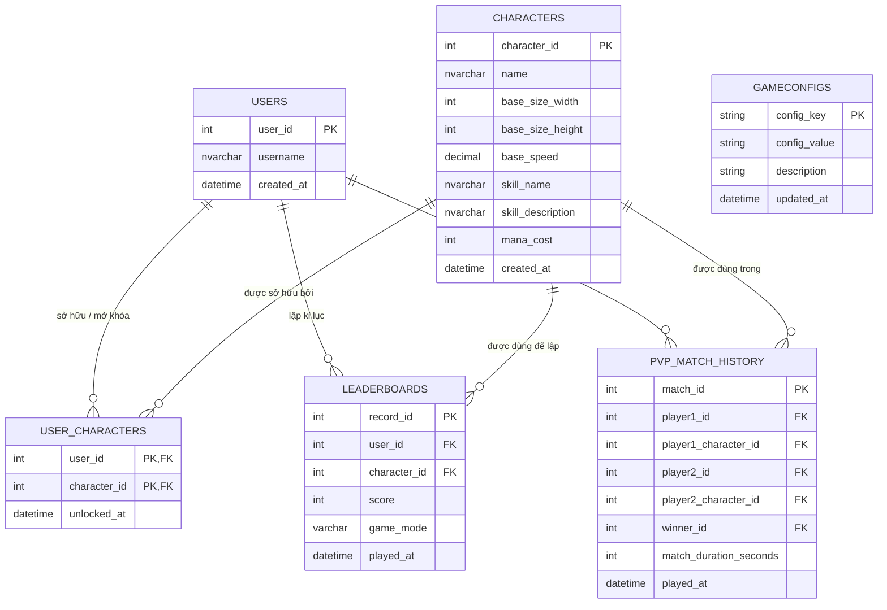

# Tài liệu Thiết kế Cơ sở dữ liệu (Database Schema)
**Dự án:** Hunter of the Sea  
**Hệ quản trị CSDL:** SQL Server (T-SQL) / H2 In-Memory Fallback  

---

## 1. Sơ đồ Quan hệ Thực thể (ERD)

---

## 2. Từ điển Dữ liệu (Data Dictionary)

### 2.1. Bảng `Users`
Lưu trữ thông tin tài khoản người chơi.
| Tên cột | Kiểu dữ liệu | Ràng buộc | Mô tả |
| :--- | :--- | :--- | :--- |
| `user_id` | INT | PK, IDENTITY(1,1) | Mã định danh người chơi (Tự tăng) |
| `username` | NVARCHAR(50) | UNIQUE, NOT NULL | Tên hiển thị trong game |
| `created_at` | DATETIME | DEFAULT GETDATE() | Thời gian tạo tài khoản |

### 2.2. Bảng `Characters`
Lưu trữ danh sách 7 Thủy Thần trong game và chỉ số mặc định:
| Tên cột | Kiểu dữ liệu | Ràng buộc | Mô tả |
| :--- | :--- | :--- | :--- |
| `character_id` | INT | PK, IDENTITY(1,1) | Mã định danh nhân vật (1: Tôm, 2: Cá Kiếm, 3: Cua, 4: Cá Ép, 5: Bạch Tuộc, 6: Cá Đuối, 7: Rùa) |
| `name` | NVARCHAR(50) | UNIQUE, NOT NULL | Tên nhân vật |
| `base_size_width` | INT | NOT NULL | Chiều rộng mặc định (vd: 2) |
| `base_size_height`| INT | NOT NULL | Chiều dài mặc định (vd: 2) |
| `base_speed` | DECIMAL(4,2)| NOT NULL | Tốc độ di chuyển cơ bản (vd: 4.80) |
| `skill_name` | NVARCHAR(100)| NOT NULL | Tên kỹ năng đặc trưng |
| `skill_description`| NVARCHAR(MAX)| | Mô tả cách thức hoạt động của kỹ năng |
| `mana_cost` | INT | DEFAULT 5 | Số vật phẩm cần ăn để đầy mana |
| `created_at` | DATETIME | DEFAULT GETDATE() | Ngày thêm vào game |

### 2.3. Bảng `User_Characters` (Bảng trung gian)
Lưu trữ kho nhân vật đã được mở khóa của từng người chơi.
| Tên cột | Kiểu dữ liệu | Ràng buộc | Mô tả |
| :--- | :--- | :--- | :--- |
| `user_id` | INT | PK, FK | Tham chiếu tới bảng `Users` |
| `character_id` | INT | PK, FK | Tham chiếu tới bảng `Characters` |
| `unlocked_at` | DATETIME | DEFAULT GETDATE() | Thời gian người chơi mở khóa nhân vật này |

### 2.4. Bảng `Leaderboards`
Lưu trữ bảng xếp hạng (High Score) của các chế độ chơi đơn (PVE / High Score).
| Tên cột | Kiểu dữ liệu | Ràng buộc | Mô tả |
| :--- | :--- | :--- | :--- |
| `record_id` | INT | PK, IDENTITY(1,1) | Mã kỉ lục |
| `user_id` | INT | FK, NOT NULL | Tham chiếu tới người lập kỉ lục (`Users`) |
| `character_id` | INT | FK, NOT NULL | Tham chiếu tới nhân vật được dùng (`Characters`) |
| `score` | INT | NOT NULL | Điểm số / Số cá ăn được |
| `game_mode` | VARCHAR(50) | NOT NULL | Chế độ (vd: `time_limit`, `endless`) |
| `played_at` | DATETIME | DEFAULT GETDATE() | Thời gian ván đấu diễn ra |

### 2.5. Bảng `Pvp_Match_History`
Lưu trữ lịch sử các trận đấu đối kháng (2 người chơi).
| Tên cột | Kiểu dữ liệu | Ràng buộc | Mô tả |
| :--- | :--- | :--- | :--- |
| `match_id` | INT | PK, IDENTITY(1,1) | Mã trận đấu |
| `player1_id` | INT | FK, NOT NULL | Tham chiếu tới người chơi 1 (`Users`) |
| `player1_character_id`| INT | FK, NOT NULL | Tham chiếu tới nhân vật của người chơi 1 |
| `player2_id` | INT | FK, NOT NULL | Tham chiếu tới người chơi 2 (`Users`) |
| `player2_character_id`| INT | FK, NOT NULL | Tham chiếu tới nhân vật của người chơi 2 |
| `winner_id` | INT | FK, NOT NULL | Tham chiếu tới người chiến thắng |
| `match_duration_seconds`| INT | NOT NULL | Tổng thời gian trận đấu diễn ra (giây) |
| `played_at` | DATETIME | DEFAULT GETDATE() | Thời gian trận đấu diễn ra |

### 2.6. Bảng `GameConfigs`
Lưu trữ cấu hình thông số toàn cầu độc lập:
| Tên cột | Kiểu dữ liệu | Ràng buộc | Mô tả |
| :--- | :--- | :--- | :--- |
| `config_key` | VARCHAR(50) | PK | Tên cấu hình (vd: `haki_buff_duration_sec`) |
| `config_value` | NVARCHAR(255)| NOT NULL | Giá trị của cấu hình (vd: `5`) |
| `description` | NVARCHAR(MAX)| | Giải thích ý nghĩa của cấu hình cho Dev |
| `updated_at` | DATETIME | DEFAULT GETDATE() | Lần cuối cấu hình được chỉnh sửa |
